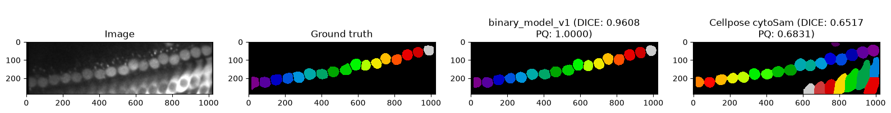
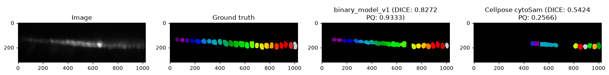

# Cochlea Inner Hair Cell Binary Segmentation U-Net 2D

[](https://huggingface.co/fedeceri/cochlea-hair-cell-binary-segmentation-UNET2d)


Small MONAI/PyTorch pipeline for 2D binary segmentation of cochlear microscopy TIFF images, with optional watershed post-processing to produce instance labels.
The model is trained to segment fluorescently-labelled inner hair cells (mostly GCaMP6) in the neonatal cochlea from in-vivo 2-photon imaging experiments ([Paper](https://www.nature.com/articles/s41467-024-55519-w)). 
The original segmentation was performed with [Cellpose](https://www.cellpose.org) and manually revised in napari.

As a result, the algorithm performs better than Cellpose in ignoring cells different from inner hair cells, such as outer hair cells or supporting cells, and in "blurry" in-vivo experiments. 




Input: single-channel `*_Avg.tif` image.  
Output: binary foreground mask, or instance-label mask after watershed post-processing.


## Files

```text
config/                                 # training configs
checkpoints/                            # local checkpoints
scripts/train_binary.py                 # config-driven training
scripts/infer_binary.py                 # single-image inference demo for HF release
src/                                    # data, model, transforms, train/validate helpers
binary_check_predictions.ipynb          # sample notebook for the binary clasification.
labelling_check_predictions.ipynb       # sample notebook for instance segmentation.
```

## Train

Training requires a config file. Epochs, workers, checkpoint paths, model settings, augmentation flags/probabilities, split settings, and data paths are read from YAML.

```bash
python scripts/train_binary.py config/binary_model_v1.yml
```

Training starts from scratch when `training.resume: false`. When `training.resume: true`, it continues from the checkpoint epoch and stops at `training.epochs`.

## Inference

The inference demo is designed for the Hugging Face release folder, where the script sits next to `config.yml` and the packaged checkpoint named by `model.best_model_path`.

```bash
python infer_binary.py input_Avg.tif --output prediction_mask.tif
```

If `--output` is omitted, the script writes `<input>_prediction.tif`.

To write watershed-separated instance labels:

```bash
python infer_binary.py input_Avg.tif --output-type labels --output prediction_labels.tif
```

